# Intro {background-color="#eef4fc"}

```{=html}
<!-- TODO: draft. Outline: TOP500 / LINPACK, exascale + GPUs, AI-driven
     hardware shift, NVIDIA FP64 throughput table, emulation as the idea. -->
```

## Why the Ozaki scheme?

- HPC ranks itself by double-precision LINPACK (TOP500)
- Accelerator hardware is shifting toward low-precision AI throughput
- **Emulation:** get FP64-accurate results out of low-precision units

::: notes
Placeholder: the Intro section is not drafted yet.
:::

# Foundations {background-color="#eef4fc"}

## Floating-point basics

$$
\text{value} = \text{mantissa} \times 2^{\text{exponent}}
$$

$$
\text{e.g.} \quad 28.016 = 1.751 \times 2^{4}
$$

. . .

Our discussion is concerned with FP64:

- 53-bit mantissa

- 11-bit exponent

. . .

Max relative error from rounding a real number to FP64:

$$
2^{-53} \approx 1.11 \times 10^{-16}
$$

::: notes
- Simplification of IEEE 754: ignoring the sign and the exponent bias.
- 52 bits are stored, but the implied leading 1 gives us 53 bits of precision.
- IEEE 754 defines the *format* of floating-point numbers, and the *result* of primitive floating-point operations.
:::

## Floating-point space

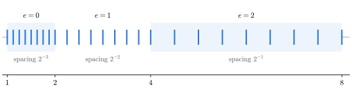{width="100%"}

- **Floating-point space:** Floating-point values are a subset of points on the real number line.

- Density of coverage decreases as magnitude grows

. . .

Density decreases as the exponent grows.

::: notes
- This is a toy format with a 4-bit mantissa, so the points are actually visible.
- Between each pair of powers of 2 there are the same number of values, evenly spaced.
- Each time the exponent goes up by one, the gap between values doubles.
- This is the usual way of picturing floating-point numbers. We're going to need a different one.
:::

## Mantissa space: One value

::::: columns
::: {.column width="28%"}
<br>

$$x_1 = 1.751 \times 2^{4}$$
:::

::: {.column width="72%"}
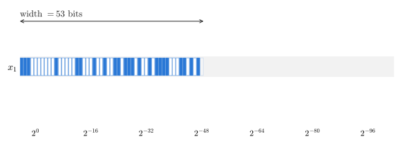{width="100%"}
:::
:::::

. . .

**Mantissa space:** Visualization of floating-point mantissas, showing the magnitude of each bit

. . .

One floating-point value: Mantissa space is 53 bits wide.

::: notes
- Mantissa space is important to the Ozaki scheme!
- Not exactly a standard technical term, but it will be very useful for us in this presentation. (Also some of the papers do kind of refer to "mantissa space".)
- Each column is one power of 2. The exponent decides where the row starts.
- Mantissa space is defined over a *set* of floating-point numbers. Here the set is just one value.
:::

## Mantissa space: Two values

::::: columns
::: {.column width="28%"}
<br>

$$x_1 = 1.751 \times 2^{4}$$ $$x_2 = 1.317 \times 2^{2}$$
:::

::: {.column width="72%"}
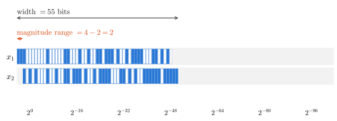{width="100%"}
:::
:::::

. . .

**Width:** Distance from the most significant bit of the highest-magnitude value to the least significant bit of the lowest-magnitude value.

. . .

**Magnitude range:** Difference in exponents of the highest- and lowest-magnitude values.

::: notes
- x2's exponent is 2 less than x1's, so its row starts 2 bits to the right.
- So the mantissa space gets 2 bits wider: 53 + 2 = 55.
:::

## Mantissa space: Three values

::::: columns
::: {.column width="28%"}
<br>

$$x_1 = 1.751 \times 2^{4}$$ $$x_2 = 1.317 \times 2^{2}$$ $$x_3 = 1.092 \times 2^{-51}$$
:::

::: {.column width="72%"}
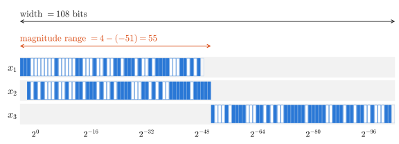{width="100%"}
:::
:::::

. . .

$x_1$ and $x_2$: Magnitude range = 2, mantissa space width = 55

. . .

$x_1$, $x_2$, and $x_3$: Magnitude range = 55, mantissa space width = 108

. . .

**Larger magnitude range → Wider mantissa space**

::: notes
- x3 is so much smaller than x1 that their bits don't overlap at all.
- Magnitude range and width of mantissa space are closely correlated: here, 55 + 53 = 108.
- But magnitude range could be measured in binary or decimal, whereas width of mantissa space is always in bits.
- Keep this picture in mind: magnitude range is going to come up again and again with the Ozaki scheme.
:::

# The Ozaki Scheme {background-color="#eef4fc"}

## Rounding

IEEE 754: Primitive operations should have results as if they were performed exactly, and then rounded to FP64.

. . .

$$
\text{max relative error of a single FLOP} = 1.11 \times 10^{-16}
$$

::: notes
- Primitive operations = addition, subtraction, multiplication, division.
- If the relative error of a result is within this bound, we say it has "FP64-equivalent accuracy."
- The error from one operation is small. The problem is when we chain a lot of them together.
:::

## Error accumulates

Rounding error can accumulate over *sequences* of floating-point operations.

. . .

For a matrix product, the max error grows with the inner dimension $n$.

. . .

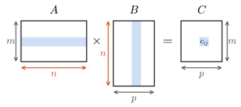{height="200px" fig-align="center"}

Each entry $c_{ij}$ is a dot product of two length-$n$ vectors.

. . .

$$
|\,\text{error}(c_{ij})\,| \lesssim n \times 1.11 \times 10^{-16} \times \sum_{k=1}^{n} |a_{ik}|\,|b_{kj}|
$$

::: notes
- A dot product of length n is n multiplications and n − 1 additions, and each one can round.
- A matrix product is a lot of dot products, so the same bound applies to every entry.
- This is a worst case. In practice it's usually better, but it can get much worse relative to the result when large terms cancel out.
:::

## Reducing rounding error

There have been many different methods for attempting to reduce error.

::::: columns
::: {.column .fragment width="50%"}
**Multiple-precision libraries**

e.g. MPFR, XBLAS

[[@bailey1995; @li2002xblas; @mpfr; @exflib]]{style="font-size: 0.5em"}
:::

::: {.column .fragment width="50%"}
**Accurate summation and dot product algorithms**

e.g. compensated sums

[[@demmel2003; @ogita2005; @rump2008a; @rump2008b]]{style="font-size: 0.5em"}
:::
:::::

<br>

::: fragment
These methods are slower than straightforward FP64 arithmetic.
:::

::: notes
- Multiple-precision libraries: carry more mantissa bits than FP64 (arbitrary precision in MPFR; double-double inside XBLAS).
- Accurate summation: e.g. compensated sums compute the rounding error of each operation and add it back in.
- Both are accurate, but slow, and they don't map onto fast matrix multiplication.
- That's where the Ozaki scheme comes in.
- Citations: the two groups Ozaki et al. (2012) list in their introduction, "a multiple-precision
  library" [2, 7, 14, 15] and "an accurate algorithm for sum and dot product" [4, 9, 11, 12].
:::

## Ozaki et al. (2012)

*Error-free transformations of matrix multiplication by using fast routines of matrix multiplication and its applications*

::::: columns
::: {.column .fragment width="55%"}
Katsuhisa Ozaki [Shibaura Institute of Technology]{style="font-size: 0.6em; color: #666"}\
Takeshi Ogita [Tokyo Woman's Christian University]{style="font-size: 0.6em; color: #666"}\
Shin'ichi Oishi [Waseda University]{style="font-size: 0.6em; color: #666"}\
Siegfried M. Rump [Waseda University; Hamburg University of Technology]{style="font-size: 0.6em; color: #666"}

Published in *Numerical Algorithms*, 2012 [@ozaki2012]
:::

::: {.column .fragment width="45%"}
::: {style="border: 2px solid #1c4e8a; border-radius: 8px; padding: 0.8em 1em; margin-top: 1.2em; background: #eef4fc"}
**Fast routine for computing matrix products with reduced rounding error**
:::
:::
:::::

::: notes
- Published online June 2011; the journal issue is 2012.
- Ozaki, Ogita and Oishi are also listed with JST/CREST (Japan Science and Technology Agency).
- Rump is listed at both Waseda and Hamburg.
:::

## Rounding in mantissa space

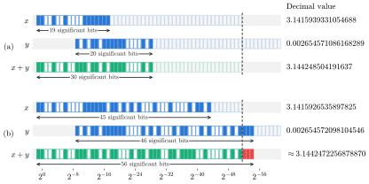{height="370px" fig-align="center"}

. . .

The result is rounded only if it doesn't fit in the 53-bit mantissa.

. . .

If the operands have few enough significant bits, the result is exact.

::: notes
- 

  (a) x and y have about 20 significant bits each. The sum fits in 53 bits: no rounding error.

- 

  (b) Same values with about 46 significant bits. The sum needs 56 bits, so the last 3 (red) are rounded away.

- Significant bits are like significant figures: the number of bits between the leading and final 1.

- For addition, the mantissas have to be aligned first, so the sum covers the mantissa space of both operands.

- This is the idea the Ozaki scheme is built on.
:::

## Splitting

Ozaki et al. build on a method from Rump et al. (2008) for splitting a floating-point value into high- and low-magnitude parts [@rump2008a].

. . .

$$
x = x^{(1)} + \underline{x}^{(2)}
$$

$$
x^{(1)} = \text{fl}\big((\sigma + x) - \sigma\big) \qquad \underline{x}^{(2)} = \text{fl}(x - x^{(1)})
$$

. . .

**Splitting factor:** $\sigma = 2^{M} \times 2^{\lceil \log_2 |x| \rceil}$, a power of 2 that is $M$ bits above $x$

::: notes
- fl( ) means "computed in floating point," so each operation is rounded.
- sigma is scaled to the magnitude of x, then pushed M bits higher.
- The trick is that we're using rounding on purpose here.
:::

## Splitting in mantissa space

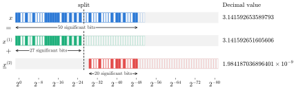{height="250px" fig-align="center"}

. . .

Adding $\sigma$ pushes the lowest $M$ bits of $x$ off the end of the mantissa, so they're rounded away.

. . .

Every slice $x^{(1)}$ has at most $53 - M$ significant bits, and the remainder $\underline{x}^{(2)}$ keeps the rest.

. . .

**Splitting gives us a mechanism for extracting a specific number of significant bits from a value.**

::: notes
- Here x = pi and M = 24: the slice x^(1) gets 27 significant bits, the remainder x_^(2) gets 20.
- Subtracting sigma back out leaves just the upper bits of x in x^(1).
- x − x^(1) is exact, so nothing is lost: x^(1) + x_^(2) is exactly x.
- We can repeat the split on the remainder to keep slicing off more bits: x^(2), x_^(3), ...
- Notation matches the matrix version: plain = slice, underlined = remainder.
:::

## Exact products

If we split $x$ and $y$ so that the slices have few enough significant bits, then $x^{(1)} y^{(1)}$ will be exact.

. . .

If we kept applying this procedure to the remainders, we could compute the product $xy$ as a sum of exact products $x^{(i)} y^{(j)}$:

$$
xy = \sum_{i=1}^{n_x} \sum_{j=1}^{n_y} x^{(i)} y^{(j)}
$$

::: notes
- Splitting repeatedly (until the remainder is zero) gives x as a sum of slices.
- This is where rounding in mantissa space comes back: few significant bits in, exact result out.
- Rounding error can only happen in the additions.
- For a dot product between length-n vectors, "few enough" is alpha = floor((53 − ceil(log2 n)) / 2) significant bits.
- Where alpha comes from: a product of two alpha-bit values has up to 2 alpha bits, and a sum of n of them needs up to log2 n more. alpha is chosen so 2 alpha + log2 n fits in 53 bits, so a whole length-n dot product between two slices is exact.
- e.g. n = 1024: alpha = 21 bits per slice. Bigger matrices mean thinner slices.
- Plugging alpha into the splitting factor (M = 53 − alpha) gives slices whose products are exact.
- In Ozaki et al., this is written with the unit roundoff u = 2^-53: alpha = floor((−log2 u − ceil(log2 n)) / 2).
:::

## The Ozaki scheme

::: incremental
1. **Decompose:** Iteratively split $A$ and $B$ into slices
2. **Multiply:** Compute slice and remainder products
3. **Accumulate:** Sum slice and remainder products
:::

::: notes
- This is the actual procedure for computing the matrix product.
- Ozaki et al. call it an "error-free transformation of matrix multiplication": one matrix product becomes an unevaluated sum of matrix products.
:::

## Decompose

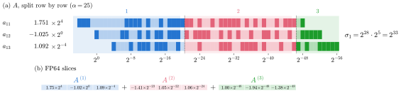{width="100%"}

. . .

Each row of $A$ gets its own splitting factor, scaled to the row's largest element.

::: notes
- (a) Our running example: A as a 1 x 3 matrix (one row, with the values of x from before). Each element's bits are colored by the slice they go to. Slice windows are alpha = 25 bits wide.
- Every row has its own windows: the first one starts at that row's largest element.
- sigma_i (right) is row i's splitting factor for the first split: 2^28 (that's 53 − alpha) times the power of 2 just above the row's largest element. Later splits recompute it from what's left of the row. With more rows, each row would get its own sigma and its own windows.
- (b) A as the sum of its three slices. Every slice is still an ordinary FP64 matrix, and its entries keep their own exponents.
- Every element in a row shares the same windows, so the products in a dot product all line up in mantissa space. That's what makes the slice products exact.
- B is split the same way, but by columns, since the dot products in AB pair rows of A with columns of B.
:::

## Decompose: Full or partial

::: {.fragment style="font-size: 0.8em"}
**Full decomposition:** Split until the remainder is zero

$$
A = A^{(1)} + \cdots + A^{(n_A)} \qquad B = B^{(1)} + \cdots + B^{(n_B)}
$$

$$
AB = \sum_{i=1}^{n_A} \sum_{j=1}^{n_B} \underbrace{A^{(i)} B^{(j)}}_{\text{exact}}
$$
:::

::: {.fragment style="font-size: 0.8em"}
**Partial decomposition:** Stop after $k - 1$ slices

$$
A = A^{(1)} + \cdots + A^{(k-1)} + \underline{A}^{(k)} \qquad B = B^{(1)} + \cdots + B^{(k-1)} + \underline{B}^{(k)}
$$

$$
AB = \underbrace{\sum_{i + j \le k} A^{(i)} B^{(j)}}_{\text{exact}} + \underbrace{\sum_{i=1}^{k-1} A^{(i)} \underline{B}^{(k-i+1)} + \underline{A}^{(k)} B}_{\text{low-magnitude remainders}}
$$
:::

::: notes
- B is split the same way, but by columns.
- Full decomposition: EFT_Mul in Ozaki et al. Gives AB as an unevaluated sum of exact matrix products.
- Partial decomposition: Acc_Mul, with k as a parameter. Only the products with i + j <= k are guaranteed exact; the terms with a remainder are computed in plain FP64, so they can round, but they're small in magnitude.
- More slices = more accuracy, but also more matrix products to compute.
:::

## Multiply

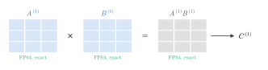{width="85%" fig-align="center"}

. . .

Each slice product is a standard FP64 matrix multiplication, and it's exact.

. . .

(Products involving remainders are also standard FP64 matrix multiplication, but not exact.)

::: notes
- No special arithmetic here: the slices are ordinary FP64 matrices, so this is a regular GEMM call.
- With partial decomposition, the products involving remainders (e.g. A_^(k) B) are still regular GEMM calls; they can round, but they're small in magnitude.
:::

## Accumulate

::::: columns
::: {.column .fragment width="50%"}
**Standard FP64 summation**

Rounding error only in the additions.
:::

::: {.column .fragment width="50%"}
**Accurate summation**

Little to no rounding error at all.
:::
:::::

<br>

::: fragment
**Result:** Matrix product that is more accurate than standard FP64
:::

::: notes
- Even with plain FP64 summation, we've removed all the rounding error from the multiplications.
- An accurate summation algorithm (like the ones from a few slides ago) only has to work on a handful of matrices, not every element-wise operation.
:::

## Impacts of implementation

::: fragment
**Optimized BLAS:** Every slice and remainder product is a standard FP64 matrix multiplication

[BLAS = Basic Linear Algebra Subprograms.]{style="font-size: 0.7em; color: #666"}

[Vendors ship BLAS implementations optimized for their hardware.]{style="font-size: 0.7em; color: #666"}
:::

<br>

::: fragment
**Memory overhead:** Every slice is a full FP64 matrix

$s$ slices of $A$ → $s \times$ the memory of $A$
:::

::: notes
- BLAS: e.g. Intel MKL, OpenBLAS, cuBLAS on NVIDIA GPUs. Ozaki et al. mention MKL, GotoBLAS and ATLAS.
- This is the big difference from the methods on the "Reducing rounding error" slide: those work one dot product at a time, so they can't use these libraries.
- The cost: several matrix products instead of one, plus the splitting and accumulation.
- Memory: two slices doubles it, three triples it, and so on, for both A and B. Ozaki et al. say up front that their algorithms "require a significant amount of working memory."
- Later slices can get sparse, so Ozaki et al. store a slice as a sparse matrix when it's mostly zeros.
- How many slices we need depends on... magnitude range.
:::

## Trade-off: Accuracy vs. performance

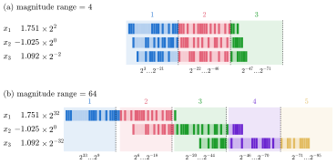{height="400px" fig-align="center"}

[Slice width $\alpha = 25$ bits (length-3 vectors)]{style="font-size: 0.6em; color: #666"}

. . .

Slices have to cover the whole mantissa space: Larger magnitude range → More slices → More slice products

. . .

**This is inherent to the scheme, not to any one implementation**

::: notes
- Same three mantissas, different exponents. (a) magnitude range 4: three slices. (b) magnitude range 64: five slices.
- Fewer slices than that: faster, but the low-magnitude bits are left in the remainders, so we lose accuracy.
- Every implementation that slices mantissa space inherits this. Faster hardware or better encodings can make each slice cheaper, but they can't make a wide mantissa space need fewer slices.
- Keep this in mind for the rest of the talk: every later implementation is still dealing with it.
:::

## Evaluation

**Goal:** Show it's a more efficient alternative to *other accurate matrix product methods*

. . .

- **Hardware:** Intel Core 2 Duo, Intel Core 2 Extreme
- **Software:** MATLAB
- **Compared against:** FP64 matrix multiplication, `lssresidual` (INTLAB), XBLAS

. . .

**Test inputs:** Matrices of uniform random values, with exponents spread out by $\phi$

$$
a_{ij} = \underbrace{(\text{rand} - 0.5)}_{\text{uniform}} \times \underbrace{e^{\,\phi \cdot \text{randn}}}_{\text{sets the exponent}}
$$

::: notes
- rand = uniform on (0, 1), randn = standard normal, drawn fresh for every entry. Bigger phi = wider spread of exponents = bigger magnitude range. Tested phi = 1, 5, 10, 15.
- Accuracy is measured against a high-precision reference computed with MPFR: max componentwise relative error.
- A second test set uses ill-conditioned A with B = inverse of A, to force heavy cancellation.
- The test cases are narrow and synthetic, but that's fine for what this paper is trying to show.
:::

## Evaluation: Results

[**M1** FP64 · **M2** `lssresidual` · [**M3–M5** Ozaki scheme, $k = 2, 3, 4$ slices]{style="color: #d9480f"} · **M6** XBLAS]{style="font-size: 0.65em"}

::: fragment
[**Accuracy** (maximum componentwise relative error)]{style="font-size: 0.6em"}

{height="150px" fig-align="center"}

[**Performance** relative to standard FP64 routines]{style="font-size: 0.6em"}

{height="150px" fig-align="center"}
:::

. . .

**Ozaki scheme: Much faster than XBLAS, with comparable accuracy**

. . .

[More slices → More accurate, but slower]{style="color: #d9480f"}

::: notes
- Top: max componentwise relative error. Bottom: computing time, normalized to plain FP64 (M1 = 1). Both from Ozaki et al. (2012), Tables 3 and 4.
- Boxed: the Ozaki scheme. Read down a column: with k fixed, error grows with phi (k = 3: 2.2e-16 at phi = 1, 5.6e-12 at phi = 15). Read across: more slices buy back accuracy, but cost more time.
- FP64 and lssresidual go the other way (FP64: 5.6e-10 at phi = 1, 6.8e-12 at phi = 15).
- XBLAS (M6) is always at 1.11e-16, but takes 85x-99x as long. The Ozaki scheme with k = 3 or 4 gets close to that in 2.4x-11.7x.
- Times for the Ozaki scheme drop at phi = 10 and 15 because later slices become sparse and are stored as sparse matrices.
- XBLAS is slower than its flop count suggests because it can't use optimized BLAS; the others can.
- Slices needed for full decomposition grow linearly with phi: 4, 6, 9, 12 slices for phi = 1, 5, 10, 15.
- Full decomposition (EFT_Mul) is 18x-151x slower than MATLAB's built-in FP64 product.
- Ill-conditioned case: at cond(A) = 10^12, FP64 has relative error ~14; the Ozaki scheme with k = 4 stays at ~2e-16.
:::

# Ozaki on IMMU {background-color="#eef4fc"}

## Tensor Cores

**Tensor Cores:** Dedicated matrix multiplication units on NVIDIA GPUs (since 2018)

. . .

Low-precision inputs, higher-precision accumulation

. . .

First Ozaki scheme on Tensor Cores used FP16-FP32 [@mukunoki2020]

::: notes
- Tensor Cores get much higher throughput than standard CUDA cores.
- Mukunoki et al. (2020): about 1.8x the peak FP64 throughput on the Titan RTX, which only has 509 GFlops of FP64.
- No speedup on the V100, a datacenter chip with 7 TFlops of FP64.
- So: a fast way to get accurate matrix products, but not yet a replacement for FP64.
- They did suggest it could be, if the trend toward low-precision hardware continued. It did.
:::

## Ootomo et al. (2024)

*DGEMM on integer matrix multiplication unit*

::::: columns
::: {.column .fragment width="55%"}
Hiroyuki Ootomo [Tokyo Institute of Technology]{style="font-size: 0.6em; color: #666"}\
Katsuhisa Ozaki [Shibaura Institute of Technology]{style="font-size: 0.6em; color: #666"}\
Rio Yokota [Tokyo Institute of Technology]{style="font-size: 0.6em; color: #666"}

Published in *The International Journal of High Performance Computing Applications*, 2024 [@ootomo2024]
:::

::: {.column .fragment width="45%"}
::: {style="border: 2px solid #1c4e8a; border-radius: 8px; padding: 0.8em 1em; margin-top: 1.2em; background: #eef4fc"}
**Ozaki scheme on integer Tensor Cores (INT8)**
:::
:::
:::::

::: notes
- IMMU = integer matrix multiplication unit. Common on AI hardware, because inference often runs on quantized integer values.
- Katsuhisa Ozaki is the same Ozaki as the 2012 paper.
:::

## Integer slices: Exponents stored separately

::::: columns
::: {.column width="58%"}
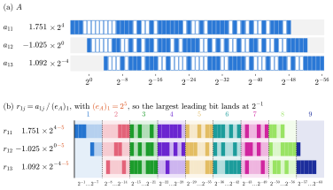{width="100%"}
:::

::: {.column width="42%"}
::: {style="font-size: 0.75em"}
::: fragment
**Problem:** INT8 Tensor Cores need integer inputs, and integers don't have exponents.
:::

::: fragment
**Fix:** Represent the exponents separately.
:::

::: fragment
Rescale each row by a power of 2, $(e_A)_i$, so its largest leading bit lands at $2^{-1}$.
:::
:::
:::
:::::

::: notes
- FP64 slices are still floating-point numbers: every element stores its own exponent. An INT8 has nowhere to put that.
- (a) Same running example A as before.
- (b) Divide the row by (e_A)_1 = 2^5, the power of 2 just above its largest element. That's computed once per row (once per column of B), and it's the same as the first splitting factor in the original scheme.
- Now every element is a fraction below 2^0, and the slice windows are fixed: 7 bits each, no need to recompute sigma for every split.
:::

## Integer slices: Block-float decomposition

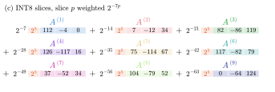{height="200px" fig-align="center"}

::: {style="font-size: 0.7em; margin-top: -0.6em"}
$$
A = \underbrace{\text{diag}(e_A)}_{\text{per-row scale}} \sum_{p=1}^{s} \underbrace{2^{-7p}}_{\text{per-slice weight}} \underbrace{A^{(p)}}_{\text{INT8}}
$$
:::

::: {style="font-size: 0.7em"}
::: fragment
**$e_A$:** Per-row scaling vector: Pulls each row's magnitude into one FP64 scalar.
:::

::: fragment
**$2^{-7p}$:** Per-slice weight: The magnitude the slice index carries, implicit.
:::

::: fragment
**$A^{(p)}$:** The actual INT8 matrix: Pure mantissa bits, no magnitude of its own.
:::

::: fragment
[$e_A$ and $e_B$ are set aside, and reapplied when the slice products are converted back to FP64.]{style="color: #d9480f"}
:::
:::

::: notes
- The figure: each slice is a row of INT8 integers. The 2^5 in orange is (e_A)_1, shared by every slice. The 2^-7p in front of each slice is never stored: it's implied by which slice it is.
- Block-float format: one block of integers, one shared exponent.
- To get back an FP64 value: integer x 2^-7p x (e_A)_i.
- B is the same, by columns: B = (sum over q of 2^-7q B^(q)) diag(e_B).
- e_A and e_B come back in the slice products: each INT32 product is converted to FP64 and multiplied by 2^-7(p+q) and e_A e_B^T before it's accumulated. That's the next slide.
:::

## Slice products on integer Tensor Cores

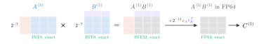{width="100%"}

. . .

INT8 × INT8 → INT32, exact.

Then convert to FP64, rescale, and accumulate in FP64.

::: notes
- The INT32 slice product is exact, like the FP64 slice products in the original scheme.
- Converting back multiplies in the slice weights and the row and column exponents e_A and e_B.
- Accumulation of the slice products is in FP64, so that's where rounding error can come in.
:::

## Evaluation: Accuracy

::::: columns
::: {.column width="55%"}
{width="100%"}
:::

::: {.column width="45%"}
::: {style="font-size: 0.75em"}
**Axes:** Max componentwise relative error vs. problem size $m$

Same synthetic matrices as Ozaki et al. (2012), with $\phi = 0.1, 1, 2, 4$.

INT8x9, x11, x13 = 9, 11, 13 slices.

::: fragment
**Larger magnitude range → More slices needed**
:::
:::
:::
:::::

::: notes
- Same random matrices as Ozaki et al., with phi = 0.1, 1, 2, 4. Error vs. a double-double reference.
- Low magnitude range: every variant beats DGEMM.
- As phi grows, INT8x9 climbs to DGEMM's error and then past it. INT8x11 also grows, more slowly. INT8x13 stays near 1e-16 throughout.
- Under heavy cancellation (A times its approximate inverse), all variants beat DGEMM, and more slices = better.
- Accuracy tests only use 128 x 128 x m.
:::

## Evaluation: Performance

{height="440px" fig-align="center"}

[Peak INT8 : FP64 throughput: **A100** 32 : 1 · **TITAN RTX** 512 : 1 · **RTX A6000** 512 : 1 · **RTX 6000 Ada** 512 : 1]{style="font-size: 0.6em; color: #666"}

. . .

Faster than native DGEMM on consumer GPUs, but **not** on the A100

::: notes
- Top row: throughput. Middle: power efficiency. Bottom: power draw.
- TITAN RTX, RTX A6000, RTX 6000 Ada: up to 3x, 4x, 6x the throughput of DGEMM. All variants run near TDP, but GFlops/W improves over DGEMM as size grows.
- A100: a datacenter chip with 19.5 TFlops of FP64 Tensor Core throughput. Native DGEMM wins, and power efficiency is much worse with emulation.
- Peak throughput (theoretical, dense INT8 Tensor Core, no sparsity), from NVIDIA specs:
  - A100 40GB: FP64 19.5 TFLOPS (Tensor Core; 9.7 without), INT8 624 TOPS → 32 : 1
  - TITAN RTX: FP64 0.51 TFLOPS (1/32 of FP32), INT8 261 TOPS → 512 : 1
  - RTX A6000: FP64 0.6 TFLOPS (1/64 of FP32), INT8 310 TOPS → 512 : 1
  - RTX 6000 Ada: FP64 1.42 TFLOPS (1/64 of FP32), INT8 728.5 TOPS → 512 : 1
- INT8x9 to INT8x13 do 45-108 INT8 GEMMs per DGEMM. With only 32x more INT8 throughput, the A100 can't win; with 512x, the consumer GPUs can.
- Ootomo et al. say integer Tensor Cores are "only up to 20 times faster" than FP64 Tensor Cores on the A100, which is lower than the 32x theoretical peak (achieved rates, presumably).
- Time breakdown (their Fig. 10): INT8 GEMMs take most of the time, FP64 accumulation is about 1/3 to 1/5, and splitting is negligible. Same breakdown on both chips.
:::

## Impacts of implementation

::: fragment
**Slice width:** An INT8 slice holds at most 8 bits (7 + sign).

FP64 slices in our running example held $\alpha = 25$ bits.

→ More slices ($3 \to 9$ for our $1 \times 3$ $A$), and more slice products
:::

::: fragment
**Memory overhead:** But an INT8 slice is 1/8 the size of an FP64 slice.

8 INT8 slices ≈ the storage of 1 FP64 slice
:::

::: fragment
**Performance:** INT8 throughput may be high enough to outperform FP64.
:::

::: fragment
**Usability:** Users still have to choose the slice count themselves.
:::

::: notes
- Slice width: in general, alpha = floor((l_acc − log2 n) / 2) with the accumulator's mantissa bits, and bits per slice BPS = min(alpha, l_in) with the input's. For INT8-INT32 the input format is the limit.
- Running example: the 1 x 3 A from the Decompose slide. FP64 slices with alpha = 25: 3 slices. INT8 slices, 7 bits each: 9 slices. Full slice products (A and B split the same way) go from 3 x 3 = 9 to 9 x 9 = 81.
- Memory: 9 INT8 slices take about the same storage as 1.125 FP64 slices, vs. 3 FP64 slices before. Plus one exponent per row/column, stored once.
- FP64 slices store an exponent for every value. Integer slices pull the exponents out, and only cover the mantissas.
- Ootomo et al. compare FP16-FP32, INT12-INT32, INT8-INT32 and INT4-INT32 on bits per slice, slice count, memory, and number of GEMMs. INT8-INT32 comes out best.
- Performance: 32:1 to 512:1 peak INT8 : FP64 on the GPUs they tested. Enough on consumer GPUs, not on the A100.
- Usability: picking a slice count means setting an accuracy target, knowing the magnitude range of your inputs, and probably trial runs. In short, manual tuning. And whether it's faster at all depends on the hardware.
:::

# Ozaki with ADP {background-color="#eef4fc"}

## Emulation in cuBLAS

2025: FP64 emulation added to cuBLAS [@nvidia2025emulation]

. . .

NVIDIA is leaning on emulation to win back FP64 performance.

::: notes
- The announcement came with speedup results for emulation.
- The HPC community knows FP64 throughput has been declining on recent NVIDIA architectures.
- Schwarz et al. describe the cuBLAS implementation, and a framework for keeping emulated DGEMM safe and efficient for users.
:::

## Schwarz et al. (2026)

*Guaranteed DGEMM Accuracy While Using Reduced Precision Tensor Cores Through Extensions of the Ozaki Scheme*

::::: columns
::: {.column .fragment width="55%"}
Angelika Schwarz, Anton Anders, Cole Brower, Harun Bayraktar, John Gunnels, Kate Clark, RuQing G. Xu, Samuel Rodriguez, Sebastien Cayrols, Pawel Tabaszewski, Victor Podlozhnyuk [NVIDIA]{style="font-size: 0.6em; color: #666"}

Published in *SCA/HPCAsia '26*, 2026 [@schwarz2026]
:::

::: {.column .fragment width="45%"}
::: {style="border: 2px solid #1c4e8a; border-radius: 8px; padding: 0.8em 1em; margin-top: 1.2em; background: #eef4fc"}
**Use emulation automatically, only when it's accurate and fast**
:::
:::
:::::

::: notes
- All 11 authors are at NVIDIA.
- SCA/HPCAsia '26: Supercomputing Asia and International Conference on High Performance Computing in Asia Pacific Region, Osaka.
:::

## Unsigned slices

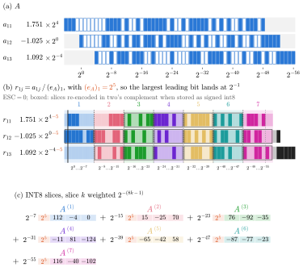{height="500px" fig-align="center"}

. . .

Only the first slice carries the sign, so every other bit holds mantissa.

::: notes
- In the original scheme, every slice can be positive or negative. But slices are pieces of one value, so only one of them needs the sign.
- The first slice is rounded toward negative infinity, so all the later slices are positive (unsigned).
- To stay on signed INT8 hardware: unsigned values in 128..255 are stored as x − 256 (same 8-bit pattern), with a +1 carry into the slice above. Boxed in the figure.
- Saves one bit per slice over Ootomo et al.
:::

## Exponent span capacity (ESC)

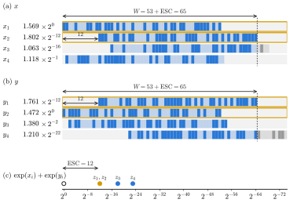{height="430px" fig-align="center"}

. . .

**ESC:** How much wider than 53 bits the mantissa space has to be, so slices cover it

::: notes
- For a dot product x^T y: x_p, y_q are the largest elements, z_r = x_r y_r is the largest term.
- ESC = exp(x_p) + exp(y_q) − exp(z_r). If the largest term comes from the largest elements, ESC = 0.
- Claim (asserted, not proved): the dot product has FP64 accuracy as long as the slices cover x_p, y_q, and the pair x_r, y_r. So we cover 53 + ESC bits.
- Here, ESC = 12, so W = 65 bits.
- Every slice holds a full 8 bits; no alpha needed for inner dimension up to 32,768.
- Goal is FP64-equivalent accuracy, not as little rounding error as possible.
:::

## Automatic Dynamic Precision (ADP)

::::: columns
::: {.column width="45%"}
{height="520px"}
:::

::: {.column width="55%"}
::: fragment
Check for Inf/NaN, compute ESC, then decide: emulate, or fall back to native DGEMM
:::

<br>

::: fragment
**Goal:** Always at least as accurate and as fast as native FP64
:::

<br>

::: fragment
The heuristic for "emulation slower than FP64?" isn't described.
:::
:::
:::::

::: notes
- Exact ESC for every dot product would be most of the way to computing the product, so ADP uses a "coarsened" ESC over blocks. Cheaper, but a looser bound on slice count.
- The heuristic is described only as ranges of known performant and non-performant slice counts. How those ranges are found isn't explained.
- The scheme isn't fully IEEE compliant for special values; ADP only checks for Inf/NaN up front.
:::

## Evaluation: Accuracy

{height="460px" fig-align="center"}

. . .

**With fallback:** Error stays at native DGEMM level, at every mantissa bit count

::: notes
- Demmel tests [@demmel2026grade]: a new suite for grading the accuracy of BLAS. This is test 2: matrices with random mantissas and exponents spread by a parameter b (b plays the role of phi).
- Without fallback, every bit count eventually blows up as b grows: not enough slices.
- With fallback, emulated DGEMM is indistinguishable from an O(n^3) algorithm like native DGEMM.
- Also meets the "grade A" bound on random uniform matrices (their Fig. 3): above native DGEMM's error, but under the bound.
- Still square, synthetic, random matrices with exponents controlled by one parameter.
:::

## Evaluation: Performance

{height="520px" fig-align="center"}

::: notes
- Speedup over native FP64 for different GEMM shapes (M = N vs. K), on GB200 (top) and RTX Pro 6000 Blackwell Server Edition (bottom), without and with ADP.
- Speedup grows with problem size. Much bigger speedups on the RTX Pro 6000 than the GB200.
- ADP costs a little speedup. On the GB200 it falls back to native more often (more 1.0s).
- Blank cells: the memory overhead was too large to run.
- Hints of a sweet spot: speedup may drop again toward the bottom right.
:::

## Impacts of implementation

::: fragment
**Performance:** Same breakdown as Ootomo et al., plus ESC overhead
:::

<br>

::: fragment
**Representation:** Unsigned slices save one bit; little room left to improve
:::

<br>

::: fragment
**Usability:** Users never have to think about magnitude range or hardware...
:::

::: fragment
... but the heuristic that makes this work is a black box
:::

::: notes
- Performance breakdown (their Fig. 5): mostly GEMMs, splitting shrinks with size. ESC overhead shrinks too, but doesn't become negligible even at the largest size. That's the cost of usability.
- Representation: integer slices were the big win. With all 8 bits now used, not much left.
- Usability: ADP gives a product at least as accurate as native FP64, in at least the same time.
- Results are reported as speedups and runtime percentages, so they can't be compared directly with other implementations.
:::

# Ozaki in Applications {background-color="#eef4fc"}

## So far: Synthetic workloads

Every evaluation so far: One matrix product, synthetic inputs

. . .

Are there matrix products in real applications that would benefit from emulation?

. . .

What happens when emulation runs inside a larger application?

::: notes
- These two questions have been left unanswered by everything we've seen so far.
:::

## Early examples

::::: columns
::: {.column .fragment width="50%"}
**Quantum circuit simulation** [@ootomo2024]

2–4.85× faster than cuBLAS ZGEMM, same or better accuracy

[(Random unitary circuits: "toy models")]{style="font-size: 0.7em; color: #666"}
:::

::: {.column .fragment width="50%"}
**QR factorization** [@schwarz2026]

Without ADP: 5× faster, error 2.9e-12

With ADP: 3.5× faster, error 7e-16
:::
:::::

::: notes
- Quantum circuits: gates are unitary matrices applied to state vectors by matrix multiplication, on complex numbers. Ootomo et al. extend the integer scheme to complex GEMM. Memory overhead 1-2 GB.
- QR factorization: not really an application, but a more complex operation built on matrix multiplication. The trailing matrix updates use emulated DGEMM.
- QR shows how accuracy holds up when the slice count is tuned to the problem.
:::

## Brower et al. (2026)

*Mixed-Precision Ab Initio Tensor Network State Methods Adapted for NVIDIA Blackwell Technology via Emulated FP64 Arithmetic*

::::: columns
::: {.column .fragment width="60%"}
[Cole Brower, Samuel Rodriguez Bernabeu, Jeff Hammond, John Gunnels [NVIDIA]{style="color: #666"}\
Sotiris S. Xantheas [Pacific Northwest National Laboratory; University of Washington]{style="color: #666"}\
Martin Ganahl [SandboxAQ]{style="color: #666"}\
Andor Menczer, Örs Legeza [Wigner Research Centre for Physics]{style="color: #666"}]{style="font-size: 0.75em"}

Published in *Journal of Chemical Theory and Computation*, 2026 [@brower2026]
:::

::: {.column .fragment width="40%"}
::: {style="border: 2px solid #1c4e8a; border-radius: 8px; padding: 0.8em 1em; margin-top: 1.2em; background: #eef4fc"}
**FP64 emulation in a real quantum chemistry application**
:::
:::
:::::

::: notes
- Uses a pre-release version of cuBLAS emulation (the Schwarz et al. implementation).
- Affiliations shortened: Menczer is also at Eötvös Loránd University; Legeza is also at Dynaflex, TU Munich's Institute for Advanced Study, and the Parmenides Stiftung.
:::

## DMRG

**DMRG:** Iterative algorithm for finding the lowest-energy state of a molecule

. . .

Every iteration: Many DGEMMs, some in rounding-sensitive steps (eigensolver, SVD)

. . .

Higher bond dimension $D$ → More accurate, but more memory and compute

::: notes
- DMRG = density matrix renormalization group.
- A molecule with N orbitals is a chain of N tensors of shape (D, 4, D). The 4: an orbital can be empty, have a spin-up electron, a spin-down electron, or both.
- Memory O(N^2 D^2), compute O(N^4 D^3).
- Every iteration updates one tensor with three subroutines that compute many DGEMMs. Two of them (Krylov eigensolver, SVD) are sensitive to rounding error.
- CAS(n, m): the active space, n electrons in m orbitals.
:::

## Accuracy: Small systems

{height="480px" fig-align="center"}

. . .

6 and 4 slices track FP64.

2 slices miss the target, and 3 is borderline.

::: notes
- F2 molecule, CAS(18,18), 200 DMRG iterations, at two values of D. Dashed line: the accuracy target.
- Same story for N2 in CAS(14,28) (their Fig. 2).
- So only 4 and 6 slices go on to the big system.
:::

## Accuracy: Large system

{height="480px" fig-align="center"}

. . .

4 and 6 slices agree with FP64 over 700 iterations.

::: notes
- Cytochrome P450 enzyme, CAS(63,58). Left: shifted ground state energy, D = 2048. Right: absolute error vs. a highly accurate reference, iterations 300-700, for D = 1024 to 4096.
- Worst absolute error 1e-4, at iteration 300. By the end, 4 slices are around 1e-5, 6 slices between just under 1e-5 and 1e-7.
- Emulated results agree with FP64 not just at the end, but throughout the computation.
:::

## Performance

{height="480px" fig-align="center"}

. . .

**Eager mode:** Emulation is slower than native FP64, even with 2 slices

::: notes
- Cumulative time in the Krylov eigensolver for F2, CAS(18,18), on a DGX B200.
- "Eager" mode always emulates. "Performant" mode emulates only when "a layer of heuristics" says it'll be faster, so it mostly tracks FP64.
- This is the smallest problem they tested. On small problems, the overhead of emulation can dominate even on hardware with plenty of low-precision throughput. Larger problems would be more informative.
- Memory overhead isn't discussed at all. DMRG is memory intensive, so it would be good to know whether a few INT8 slices matter.
:::

# Discussion {background-color="#eef4fc"}

## Tracing the Ozaki scheme

```{=html}
<div style="display: flex; align-items: stretch; justify-content: space-between; gap: 0.3em; margin-top: 1.2em; font-size: 0.6em; text-align: center">
  <div style="flex: 2; border: 2px solid #1c4e8a; border-radius: 8px; padding: 0.6em; background: #eef4fc">
    <b>Error-free matrix multiplication</b><br><span style="color: #666">Ozaki et al. (2012)</span>
  </div>
  <div class="fragment" data-fragment-index="1" style="flex: 1.2; display: flex; flex-direction: column; justify-content: center; color: #d9480f">
    <span style="font-size: 2em">→</span><b>Hardware</b>
  </div>
  <div style="flex: 2; border: 2px solid #1c4e8a; border-radius: 8px; padding: 0.6em; background: #eef4fc">
    <b>Integer Tensor Cores</b><br><span style="color: #666">Ootomo et al. (2024)</span>
  </div>
  <div class="fragment" data-fragment-index="2" style="flex: 1.2; display: flex; flex-direction: column; justify-content: center; color: #d9480f">
    <span style="font-size: 2em">→</span><b>Usability</b>
  </div>
  <div style="flex: 2; border: 2px solid #1c4e8a; border-radius: 8px; padding: 0.6em; background: #eef4fc">
    <b>ADP</b><br><span style="color: #666">Schwarz et al. (2026)</span>
  </div>
  <div class="fragment" data-fragment-index="3" style="flex: 1.2; display: flex; flex-direction: column; justify-content: center; color: #d9480f">
    <span style="font-size: 2em">→</span><b>Stability</b>
  </div>
  <div style="flex: 2; border: 2px solid #1c4e8a; border-radius: 8px; padding: 0.6em; background: #eef4fc">
    <b>Applications</b><br><span style="color: #666">Brower et al. (2026)</span>
  </div>
</div>
```

::: notes
- We've tracked the exact modifications made to the scheme at each step. Now: what does each step actually buy us?
- Hardware: the speedups. Usability: making it safe to turn on. Stability: it holds up inside a real application.
:::

## Ozaki (2012) → Integer Tensor Cores: Hardware

::: fragment
**What changed:** Block-float INT8 slices, exact INT32 slice products, FP64 accumulation
:::

::: fragment
**None of it makes the scheme do less work:** More slices ($3 \to 9$), more slice products
:::

::: fragment
**What changed underneath:** 512 : 1 INT8 : FP64 throughput on consumer GPUs, only 32 : 1 on the A100
:::

<br>

::: fragment
**Nothing about the implementation explains the speedups.**

**It's a hardware story.**
:::

::: notes
- The splitting is the same idea as 2012, just with fixed windows. The slice products are still exact. Accumulation is still FP64.
- Memory overhead does go down with integer slices. That's a real improvement, but it's not what makes it fast.
- Ootomo's time breakdown: INT8 GEMMs dominate, splitting is negligible. So performance just tracks INT8 GEMM throughput.
- And where the hardware ratio isn't there (A100), there's no speedup.
- Even the first speedup over FP64 (Mukunoki et al., FP16 Tensor Cores, 2020) only happened once Tensor Cores existed.
:::

## Integer Tensor Cores → ADP: Usability

::: fragment
**A strong effort toward usability:** ESC picks the slice count, ADP picks emulation or native FP64
:::

<br>

::: fragment
**But a lot of handwaving:**
:::

::: fragment
What is the heuristic that decides whether emulation is performant?
:::

::: fragment
How do we know ESC's slice counts keep FP64-level accuracy?
:::

::: notes
- Before ADP, users had to pick a slice count and know their hardware. ADP takes both off the user's plate, with fallback to native.
- The heuristic: described only as ranges of known performant and non-performant slice counts. How those ranges are found isn't explained. It's a black box.
- ESC: based on a claim that covering the largest elements and the largest term is enough for FP64 accuracy. Asserted without proof.
- The evidence for it is empirical: Demmel tests, on synthetic matrices.
:::

## ADP → Applications: Stability

::: fragment
**Stable in a real application:** 4–6 slices track FP64 over hundreds of DMRG iterations
:::

::: fragment
**But not useful for every application or problem size:** Slower than native FP64 on the DMRG problem they timed
:::

<br>

::: fragment
Some of that is choosing the wrong problem.

On small problems, emulation just isn't going to help.
:::

::: notes
- Accuracy holds not just at the end, but throughout the computation.
- The timed problem (F2, CAS(18,18)) is the smallest one they ran. Eager emulation was slower even with 2 slices, which weren't accurate enough anyway.
- We've seen this pattern across the papers: emulation overhead dominates at small sizes, and speedup grows with problem size.
- Memory overhead in the application isn't reported.
:::

## What the evidence tells us

::: fragment
Every speedup we've seen is on hardware where FP64 has been deprioritized for AI.
:::

::: fragment
Every accuracy test before DMRG uses synthetic matrices, with one magnitude-range parameter.
:::

<br>

::: fragment
**What we can conclude: On AI-dedicated hardware, we can get speedups.**
:::

::: fragment
Not: Emulation can replace native FP64.
:::

::: notes
- Whether emulation beats native FP64 is always conditional on: the INT8-to-FP64 throughput ratio of the hardware, the magnitude range of the inputs, and the problem size.
- Real applications may have structure (sparsity, banding, block structure, extreme aspect ratios), and how emulation interacts with that hasn't been probed.
- The moderate position: the Ozaki scheme is a useful tool where it is useful.
:::

## Discussion (continued)

- Practicality: hardware ratio, slice count, ESC overhead
- The Ozaki scheme as a variable-precision method
- Future work

::: notes
Placeholder: not drafted yet.
:::

# Conclusion {background-color="#eef4fc"}

<!-- TODO: AMD FP64 hardware, INT8 vs FP8 support, Ozaki-II -->

## Everything else

- NVIDIA isn't the only GPU vendor: AMD's HPC parts keep strong FP64 throughput
- Is INT8 support here to stay?
- Ozaki-II

## References {.smaller .scrollable}

::: {#refs}
:::
